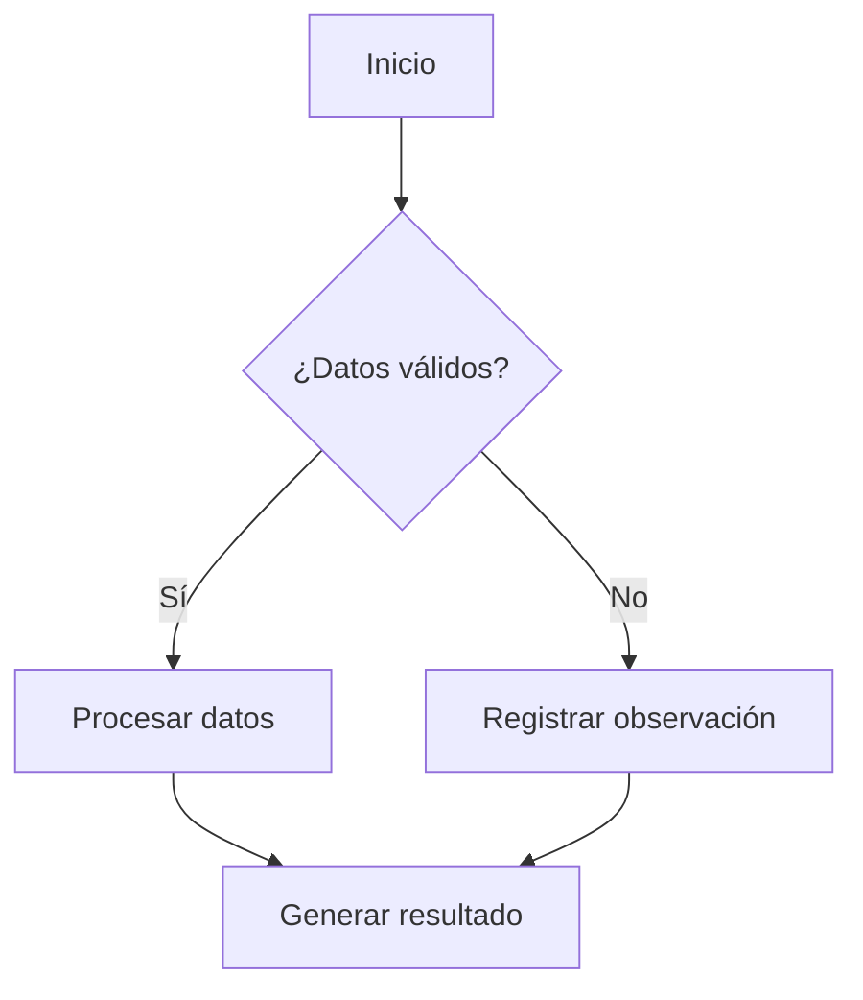
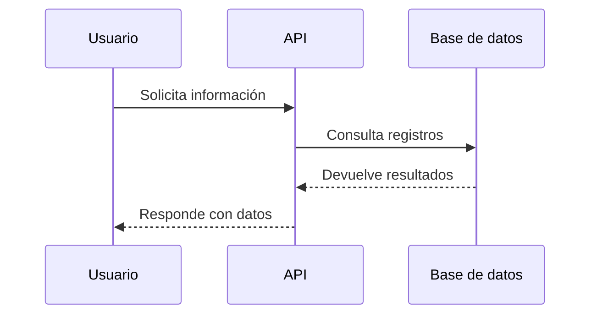
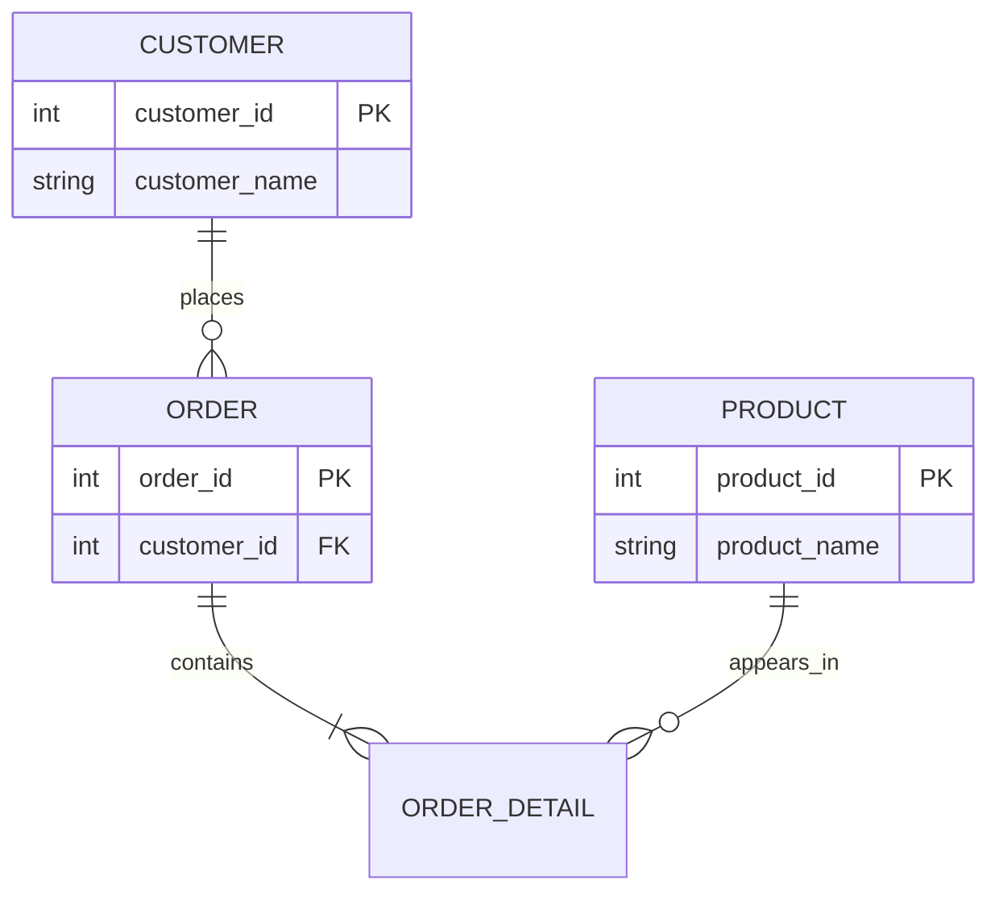
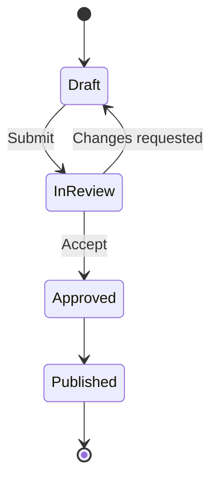
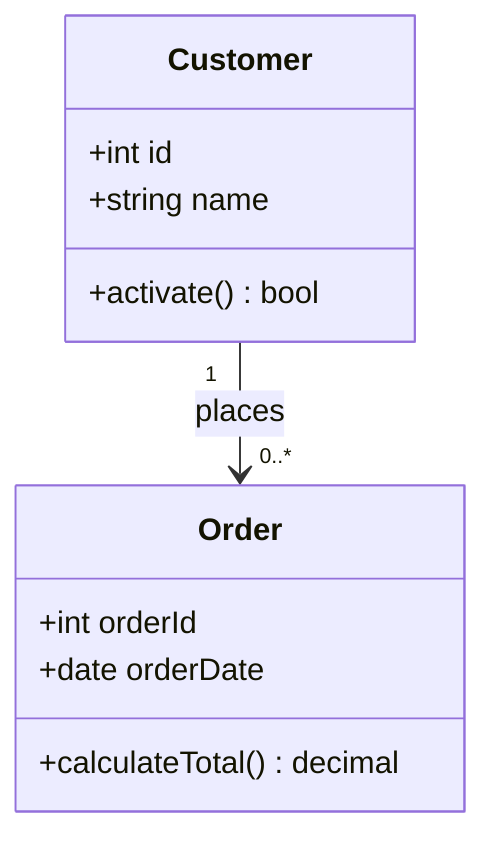
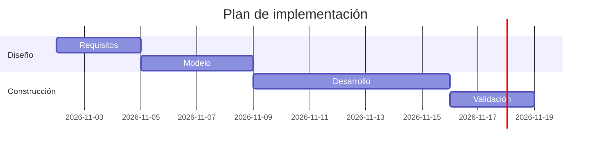

# Guía amplia de Markdown y funciones del preview de Visual Studio Code

**Objetivo:** reunir ejemplos reutilizables para documentación técnica, notas, manuales, procedimientos, informes y archivos README.

**Alcance:** esta guía conserva la sintaxis básica de Markdown y también incluye, en secciones claramente identificadas, extensiones GFM y funciones específicas del preview de VS Code que incorporaste manualmente: HTML, Mermaid, fórmulas matemáticas con KaTeX, Front Matter YAML y estilos CSS opcionales.

**Compatibilidad:** los ejemplos de Markdown básico funcionan sin configuración adicional. Las tablas, el tachado y las casillas se identifican como extensiones GFM. Mermaid y KaTeX son funciones del preview integrado de VS Code en versiones actuales; Front Matter tiene una representación propia en VS Code. Los ejemplos HTML/CSS de personalización son opcionales y requieren las condiciones explicadas en su sección.

> **Nota importante:** Markdown no define colores de texto, estilos personalizados de tablas, bordes dobles o punteados, diagramas Mermaid, fórmulas LaTeX ni metadatos Front Matter. Se conservan porque forman parte de la combinación manual que preparaste, pero se explican por separado para que no se confundan con la sintaxis Markdown estándar.

---

## Índice

1. [Abrir la vista previa en VS Code](#1-abrir-la-vista-previa-en-vs-code)
2. [Conceptos y reglas básicas](#2-conceptos-y-reglas-basicas)
3. [Títulos y encabezados](#3-titulos-y-encabezados)
4. [Párrafos, saltos de línea y separadores](#4-parrafos-saltos-de-linea-y-separadores)
5. [Formato de texto](#5-formato-de-texto)
6. [Listas](#6-listas)
7. [Citas, notas y bloques informativos](#7-citas-notas-y-bloques-informativos)
8. [Enlaces y referencias](#8-enlaces-y-referencias)
9. [Imágenes](#9-imagenes)
10. [Tablas y alineación — GFM](#10-tablas-y-alineacion--gfm)
11. [Bloques de código](#11-bloques-de-codigo)
12. [Ejemplos de distintos lenguajes](#12-ejemplos-de-distintos-lenguajes)
13. [Árboles de carpetas y jerarquías](#13-arboles-de-carpetas-y-jerarquias)
14. [Símbolos y caracteres especiales](#14-simbolos-y-caracteres-especiales)
15. [Escapar caracteres de Markdown](#15-escapar-caracteres-de-markdown)
16. [HTML dentro de Markdown](#16-html-dentro-de-markdown)
17. [Diagramas Mermaid](#17-diagramas-mermaid)
18. [Fórmulas matemáticas con KaTeX](#18-formulas-matematicas-con-katex)
19. [Contenido plegable](#19-contenido-plegable)
20. [Comentarios y contenido oculto](#20-comentarios-y-contenido-oculto)
21. [Front Matter YAML](#21-front-matter-yaml)
22. [Ejemplo integrado de documento completo](#22-ejemplo-integrado-de-documento-completo)
23. [Plantilla reutilizable de documento completo](#23-plantilla-reutilizable-de-documento-completo)
24. [Personalización opcional mediante HTML y CSS](#24-personalizacion-opcional-mediante-html-y-css)
25. [Limitaciones, diferencias y compatibilidad](#25-limitaciones-diferencias-y-compatibilidad)
26. [Resumen rápido de sintaxis](#26-resumen-rapido-de-sintaxis)
27. [Referencias oficiales](#27-referencias-oficiales)

---
## 1. Abrir la vista previa en VS Code

1. Abre este archivo `.md` en Visual Studio Code.
2. Haz clic derecho en la pestaña del archivo y selecciona **Open Preview to the Side**.
3. También puedes abrir la paleta de comandos con `Ctrl+Shift+P` y ejecutar `Markdown: Open Preview to the Side`.
4. Atajo para abrir la vista previa al lado del editor: `Ctrl+K`, seguido de `V`.
5. Atajo para abrir la vista previa en la pestaña actual: `Ctrl+Shift+V`.

La vista previa integrada de VS Code se actualiza mientras editas el archivo. Puedes mantener el código Markdown a la izquierda y el resultado visual a la derecha.

---

## 2. Conceptos y reglas básicas

Markdown es un lenguaje de marcado ligero. Se escribe como texto plano y se utilizan caracteres sencillos para indicar encabezados, listas, citas, enlaces, imágenes y bloques de código.

### 2.1 Reglas prácticas

- Deja una línea en blanco entre párrafos y, normalmente, antes y después de listas, citas y bloques de código.
- Deja un espacio después de los signos `#` de un encabezado: `## Título`.
- Usa una indentación consistente en las listas anidadas.
- Para bloques de código utiliza tres acentos graves: `` ``` ``.
- Para mostrar literalmente un carácter especial, utiliza una barra invertida `\` delante del carácter.
- El formato Markdown define la estructura del documento; no permite controlar de forma portable los colores, fuentes o bordes del visor.

### 2.2 Tabla de sintaxis básica

| Elemento | Sintaxis | Uso |
|:--|:--|:--|
| Encabezado | `# Título` | Título de nivel 1 |
| Negrita | `**texto**` | Énfasis fuerte |
| Cursiva | `*texto*` | Énfasis |
| Código en línea | `` `código` `` | Comandos o nombres de variables |
| Cita | `> texto` | Nota o cita |
| Lista con viñetas | `- elemento` | Elementos sin orden |
| Lista numerada | `1. elemento` | Pasos secuenciales |
| Enlace | `[texto](https://ejemplo.com)` | Referencia web |
| Imagen | `` | Imagen con texto alternativo |
| Bloque de código | ```` ```python ```` | Código con identificador de lenguaje |
| Separador | `---` | Separación temática |

---

## 3. Títulos y encabezados

Markdown define **seis niveles de encabezado**. El nivel 1 suele reservarse para el título principal del documento. No existe un séptimo nivel.

### 3.1 Ejemplos de los seis niveles

# Título de nivel 1 — H1

## Título de nivel 2 — H2

### Título de nivel 3 — H3

#### Título de nivel 4 — H4

##### Título de nivel 5 — H5

###### Título de nivel 6 — H6

### 3.2 Sintaxis de cada nivel

| Nivel | Sintaxis |
|:--:|:--|
| H1 | `# Título` |
| H2 | `## Título` |
| H3 | `### Título` |
| H4 | `#### Título` |
| H5 | `##### Título` |
| H6 | `###### Título` |

### 3.3 Otra forma de escribir H1 y H2

Markdown también permite encabezados de estilo subrayado para los dos primeros niveles:

```markdown
Título de nivel 1
=================

Título de nivel 2
-----------------
```

Resultado:

Título de nivel 1
=================

Título de nivel 2
-----------------

### 3.4 Enlaces internos a encabezados

Puedes enlazar una sección del mismo documento utilizando su identificador generado por el visor:

```markdown
[Ir a la sección de tablas](#10-tablas-extension-gfm)
[Ir al resumen de sintaxis](#26-resumen-rapido-de-sintaxis)
```

[Ir a la sección de tablas](#10-tablas-extension-gfm) · [Ir al resumen de sintaxis](#26-resumen-rapido-de-sintaxis)

La conversión del encabezado a un identificador puede variar ligeramente según el motor Markdown, sobre todo si contiene tildes o signos de puntuación.

---

## 4. Párrafos, saltos de línea y separadores

### 4.1 Párrafos

Este es el primer párrafo. Una línea en blanco indica que comienza un párrafo nuevo.

Este es el segundo párrafo. Si solo pulsas Enter y no dejas una línea en blanco, el motor Markdown puede unir las líneas en el mismo párrafo.

### 4.2 Salto de línea dentro del mismo párrafo

En Markdown puedes terminar una línea con dos espacios y luego pulsar Enter. También puedes utilizar una barra invertida al final de la línea.

Primera línea con dos espacios al final.  
Segunda línea del mismo párrafo.

Primera línea con barra invertida al final.\
Segunda línea del mismo párrafo.

**Consejo:** algunos formateadores eliminan espacios al final de una línea. La barra invertida es una alternativa visible para indicar el salto.

### 4.3 Separadores horizontales

Se pueden utilizar tres o más guiones, asteriscos o guiones bajos en una línea independiente:

```markdown
---

***

___
```

Ejemplos:

---

***

___

Estos separadores crean una línea horizontal sencilla. Markdown no permite elegir mediante su sintaxis si la línea debe ser doble, punteada o de otro color.

---

## 5. Formato de texto

| Efecto | Cómo escribirlo | Resultado |
|:--|:--|:--|
| Negrita | `**Texto en negrita**` | **Texto en negrita** |
| Cursiva | `*Texto en cursiva*` | *Texto en cursiva* |
| Negrita y cursiva | `***Texto***` | ***Texto*** |
| Tachado | `~~Texto tachado~~` | ~~Texto tachado~~ |
| Código en línea | `` `SELECT * FROM dbo.Clientes;` `` | `SELECT * FROM dbo.Clientes;` |
| Cita corta | `> Texto citado` | Bloque de cita |
| HTML: resaltado | `<mark>Texto</mark>` | Ver sección 16: HTML |
| HTML: subíndice | `H<sub>2</sub>O` | Ver sección 16: HTML |
| HTML: superíndice | `x<sup>2</sup>` | Ver sección 16: HTML |
| HTML: tecla | `<kbd>Ctrl</kbd>` | Ver sección 16: HTML |
| HTML: texto pequeño | `<small>Texto</small>` | Ver sección 16: HTML |


### 5.1 Negrita

Sintaxis: `**texto**` o `__texto__`.

**Este texto está en negrita.**

__Este texto también está en negrita.__

### 5.2 Cursiva

Sintaxis: `*texto*` o `_texto_`.

*Este texto está en cursiva.*

_Este texto también está en cursiva._

### 5.3 Negrita y cursiva combinadas

Sintaxis: `***texto***`.

***Este texto está en negrita y cursiva.***

### 5.4 Énfasis dentro de una oración

En un documento técnico puedes combinar texto normal, **conceptos importantes**, *términos destacados* y `nombres_de_variables`.

### 5.5 Tachado — extensión GFM

La sintaxis `~~texto~~` es una extensión muy extendida, pero no forma parte del núcleo CommonMark:

~~Este texto aparece tachado en los visores compatibles.~~

### 5.6 Código en línea

Utiliza un acento grave antes y después del fragmento:

Ejemplo: ejecuta `SELECT * FROM dbo.Customers;` y revisa la variable `customer_id`.

Para mostrar un acento grave dentro del propio código, puedes envolver el fragmento con dos acentos graves:

``Use ` para escribir código en línea``

### 5.7 Énfasis semántico sin colores

Markdown no permite definir colores de texto de forma estándar. Para destacar información utiliza encabezados, **negrita**, *cursiva*, citas y etiquetas escritas en palabras:

> **IMPORTANTE:** valida los datos antes de ejecutar el proceso.

> **ADVERTENCIA:** confirma el impacto antes de modificar información productiva.

> **NOTA:** registra la evidencia y la fecha de la validación.

### 5.8 Combinación de formatos

Puedes combinar negrita, cursiva y código en línea: **texto importante**, *énfasis*, ***énfasis fuerte*** y `variable_name`.

### 5.9 Caracteres reservados y escape

Anteponer una barra invertida permite mostrar caracteres que Markdown normalmente interpreta como formato:

```markdown
\* Esto no será cursiva \*
\# Esto no será un encabezado
\- Esto no será una viñeta
\[Esto no será un enlace\]
```

Resultado: \* Esto no será cursiva \*.

---

## 6. Listas

### 6.1 Lista con guiones

```markdown
- Primer elemento
- Segundo elemento
- Tercer elemento
```

Resultado:

- Primer elemento
- Segundo elemento
- Tercer elemento

### 6.2 Lista con asteriscos

```markdown
* Primer elemento
* Segundo elemento
* Tercer elemento
```

Resultado:

* Primer elemento
* Segundo elemento
* Tercer elemento

### 6.3 Lista con signos más

```markdown
+ Primer elemento
+ Segundo elemento
+ Tercer elemento
```

Resultado:

+ Primer elemento
+ Segundo elemento
+ Tercer elemento

Los marcadores `-`, `*` y `+` crean listas con viñetas. Conviene mantener un único marcador dentro de cada lista.

### 6.4 Lista numerada

```markdown
1. Primer paso
2. Segundo paso
3. Tercer paso
```

Resultado:

1. Primer paso
2. Segundo paso
3. Tercer paso

### 6.5 Numeración automática

También puedes escribir `1.` en todos los elementos. El visor calculará los números consecutivos:

```markdown
1. Primer paso
1. Segundo paso
1. Tercer paso
```

Resultado:

1. Primer paso
1. Segundo paso
1. Tercer paso

### 6.6 Lista que comienza en otro número

```markdown
5. Quinto paso
6. Sexto paso
7. Séptimo paso
```

Resultado:

5. Quinto paso
6. Sexto paso
7. Séptimo paso

### 6.7 Listas anidadas

Para crear subniveles, indenta los elementos secundarios con espacios:

```markdown
- Proyecto
  - Planeación
    - Requisitos
    - Cronograma
  - Ejecución
    - Desarrollo
    - Pruebas
  - Cierre
```

Resultado:

- Proyecto
  - Planeación
    - Requisitos
    - Cronograma
  - Ejecución
    - Desarrollo
    - Pruebas
  - Cierre

### 6.8 Lista numerada con subelementos

1. Análisis
   - Identificar las fuentes.
   - Documentar los requisitos.
2. Diseño
   - Definir la arquitectura.
   - Validar el modelo.
3. Implementación
   - Desarrollar la solución.
   - Ejecutar las pruebas.

### 6.9 Números romanos escritos manualmente

Markdown no incluye una numeración automática romana. Puedes escribir los números romanos como parte del texto de cada viñeta:

- **I. Introducción**
- **II. Alcance**
- **III. Diseño**
- **IV. Implementación**
- **V. Conclusiones**

Para subapartados:

- **I. Introducción**
  - **i.** Contexto
  - **ii.** Objetivo
- **II. Desarrollo**
  - **i.** Análisis
  - **ii.** Resultados

El número romano no se incrementa automáticamente; debes editarlo manualmente.

Markdown estándar no incluye un marcador automático de números romanos. Puedes escribirlos manualmente como en los ejemplos anteriores. Si aceptas HTML (no Markdown puro), algunos renderizadores también muestran listas romanas mediante `<ol type="I">` o `<ol type="i">`:

<ol type="I">
  <li>Introducción</li>
  <li>Alcance</li>
  <li>Diseño</li>
  <li>Implementación</li>
</ol>

<ol type="i">
  <li>Primer detalle</li>
  <li>Segundo detalle</li>
  <li>Tercer detalle</li>
</ol>

También existen los tipos alfabéticos:

<ol type="A">
  <li>Alternativa A</li>
  <li>Alternativa B</li>
</ol>

<ol type="a">
  <li>Opción a</li>
  <li>Opción b</li>
</ol>


### 6.10 Lista de verificación con símbolos

Las casillas de tareas `- [ ]` pertenecen a GFM y su representación depende del visor. Para una lista visual sencilla sin depender de controles especiales, puedes utilizar caracteres Unicode.

Sintaxis habitual de GitHub Flavored Markdown (GFM):

```markdown
- [x] Actividad terminada
- [ ] Actividad pendiente
- [ ] Actividad en proceso
```

Las casillas `- [ ]` y `- [x]` son una extensión GFM y su presentación puede variar entre renderizadores. Si el visor de destino no las representa como casillas, utiliza la alternativa simple con símbolos Unicode:

- ☑ Actividad completada
- ☐ Actividad pendiente
- ◐ Actividad en progreso
- ⚠ Actividad que requiere revisión

### 6.11 Listas con párrafos y varios renglones

- **Primer elemento:** este elemento contiene una explicación más larga que puede continuar en el siguiente renglón del mismo párrafo.

  Este es un segundo párrafo que pertenece al primer elemento de la lista.

- **Segundo elemento:** continúa la lista después del párrafo anterior.

### 6.12 Lista de pasos con explicaciones

1. **Preparar:** identificar los archivos de entrada y validar sus formatos.
2. **Procesar:** ejecutar las transformaciones y registrar los resultados.
3. **Verificar:** comparar los resultados con los criterios de aceptación.
4. **Documentar:** guardar evidencias, observaciones y conclusiones.

---

## 7. Citas, notas y bloques informativos

### 7.1 Cita sencilla

```markdown
> Esta es una cita o una observación tomada de otra fuente.
```

Resultado:

> Esta es una cita o una observación tomada de otra fuente.

### 7.2 Cita con varios párrafos

> Este es el primer párrafo de la cita.
>
> Este es el segundo párrafo de la misma cita.

### 7.3 Citas anidadas

> Nivel de cita principal.
>
> > Nivel de cita secundario.
> >
> > > Nivel de cita terciario.

### 7.4 Notas y advertencias

Markdown no define tipos de recuadros de colores para notas. Una alternativa estándar es utilizar citas y etiquetas de texto:

> **NOTA:** utiliza este espacio para aclaraciones importantes.

> **CONSEJO:** incluye aquí una recomendación práctica.

> **ADVERTENCIA:** documenta riesgos, dependencias o acciones que requieren validación.

> **ERROR:** describe el problema y su impacto.

> **ÉXITO:** registra el resultado alcanzado y su evidencia.

### 7.5 Cita con atribución

> La calidad de los datos debe evaluarse mediante reglas definidas, medibles y verificables.
>
> — **Fuente:** nombre del documento o autor, fecha y enlace.

### 7.6 Bloque de texto de referencia

> **Definición — ETL**  
> ETL significa *Extract, Transform, Load*: extraer, transformar y cargar datos.
>
> **Definición — ELT**  
> ELT significa *Extract, Load, Transform*: extraer, cargar y transformar datos.


### 7.7 Texto de autor y fuente

> “La calidad de los datos depende de controles definidos, medibles y verificables.”
>
> — Ejemplo de cita, **fuente:** nombre del documento o autor, fecha y enlace.


---

## 8. Enlaces y referencias

### 8.1 Enlace directo

Sintaxis:

```markdown
[Documentación de Visual Studio Code](https://code.visualstudio.com/docs/languages/markdown)
```

Resultado: [Documentación de Visual Studio Code](https://code.visualstudio.com/docs/languages/markdown).

### 8.2 URL visible como texto

Escribe la dirección completa como enlace entre signos angulares:

```markdown
<https://code.visualstudio.com/>
```

Resultado: <https://code.visualstudio.com/>

### 8.3 Enlace de correo electrónico

```markdown
<mailto:equipo@example.com>
```

Resultado: <mailto:equipo@example.com>

### 8.4 Enlace con referencia

Puedes definir el destino una sola vez y reutilizarlo en el documento:

```markdown
Consulta la [documentación oficial][vscode].
También puedes revisar la [especificación CommonMark][commonmark].

[vscode]: https://code.visualstudio.com/docs/languages/markdown
[commonmark]: https://commonmark.org/
```

Resultado: consulta la [documentación oficial][vscode] y la [especificación CommonMark][commonmark].

[vscode]: https://code.visualstudio.com/docs/languages/markdown
[commonmark]: https://commonmark.org/

### 8.5 Referencia abreviada

```markdown
Consulta la [documentación oficial][] para obtener más información.

[documentación oficial]: https://code.visualstudio.com/docs/languages/markdown
```

### 8.6 Enlace interno a otra sección

```markdown
[Consultar la sección de listas](#6-listas)
```

[Consultar la sección de listas](#6-listas)

### 8.7 Enlace a otro archivo Markdown

Las rutas relativas permiten conectar documentos del mismo repositorio:

```markdown
[Arquitectura](./Arquitectura.md)
[Guía de instalación](./docs/Instalacion.md)
[Sección de componentes](./Arquitectura.md#componentes-principales)
```

### 8.8 Referencias bibliográficas numeradas

Markdown básico no define notas al pie automáticas. Puedes organizar las fuentes como una lista numerada y enlazarlas desde el texto:

Consulta la documentación de [CommonMark][fuente-1] y la guía de [Markdown de VS Code][fuente-2].

1. [CommonMark Specification][fuente-1]
2. [Visual Studio Code — Markdown][fuente-2]

[fuente-1]: https://spec.commonmark.org/
[fuente-2]: https://code.visualstudio.com/docs/languages/markdown

### 8.9 Enlaces con título emergente

```markdown
[CommonMark](https://spec.commonmark.org/ "Especificación de Markdown")
```

Resultado: [CommonMark](https://spec.commonmark.org/ "Especificación de Markdown").

---

## 9. Imágenes

### 9.1 Imagen local

```markdown

```

### 9.2 Imagen alojada en Internet

```markdown

```

### 9.3 Imagen con referencia

```markdown
![Diagrama del sistema][diagrama-sistema]

[diagrama-sistema]: ./images/diagrama-sistema.png "Diagrama general del sistema"
```

### 9.4 Imagen que también funciona como enlace

```markdown
[](https://example.com/)
```

### 9.5 Recomendaciones para imágenes

- Utiliza rutas relativas para imágenes almacenadas junto al proyecto.
- Guarda los recursos en carpetas como `images/` o `assets/`.
- Escribe un texto alternativo descriptivo entre los corchetes.
- Comprueba que el archivo existe y que la ruta coincide en mayúsculas y minúsculas.
- Para imágenes remotas, considera que el destino donde publiques el Markdown debe permitir cargar ese recurso.

---

## 10. Tablas y alineación (GFM)

Las tablas con barras verticales son una extensión de uso común conocida como GitHub Flavored Markdown (GFM). No forman parte del núcleo estricto de CommonMark, pero se muestran en la vista previa integrada de VS Code sin necesidad de CSS personalizado.

En VS Code, la vista previa integrada muestra estas tablas sin que tengas que añadir una hoja CSS. Markdown/GFM ofrece tablas sencillas mediante barras verticales (`|`) y una fila separadora con guiones (`-`). Los dos puntos (`:`) de esa fila controlan la alineación. El estilo visual de los bordes depende del tema y del renderizador.

### 10.1 Ejemplo mínimo de tabla

```markdown
| ID | Nombre | Estado |
|----|--------|--------|
| 1  | Cliente | Activo |
| 2  | Producto | Pendiente |
```

| ID | Nombre | Estado |
|----|--------|--------|
| 1 | Cliente | Activo |
| 2 | Producto | Pendiente |


### 10.2 Tabla con tres registros

```markdown
| ID | Nombre | Estado |
|----|--------|--------|
| 1  | Cliente | Activo |
| 2  | Producto | Pendiente |
| 3  | Factura | Completado |
```

Resultado:

| ID | Nombre | Estado |
|----|--------|--------|
| 1 | Cliente | Activo |
| 2 | Producto | Pendiente |
| 3 | Factura | Completado |

### 10.3 Tabla con alineación a la izquierda, centro y derecha


```markdown
| Columna izquierda | Columna centrada | Columna derecha |
|:------------------|:----------------:|----------------:|
| Texto a la izquierda | Texto al centro | 100 |
| Otro texto | Otro valor | 2500 |
```

| Columna izquierda | Columna centrada | Columna derecha |
|:------------------|:----------------:|----------------:|
| Texto a la izquierda | Texto al centro | 100 |
| Otro texto | Otro valor | 2500 |

Regla de alineación:

| Sintaxis del separador | Alineación |
|:--|:--|
| `:---` | Izquierda |
| `:---:` | Centro |
| `---:` | Derecha |
| `---` | Predeterminada (normalmente izquierda) |


```markdown
| Izquierda | Centro | Derecha |
|:----------|:------:|--------:|
| Texto A   | Texto B | 100 |
| Texto C   | Texto D | 2500 |
```

Resultado:

| Izquierda | Centro | Derecha |
|:----------|:------:|--------:|
| Texto A | Texto B | 100 |
| Texto C | Texto D | 2500 |

### 10.4 Reglas de alineación

| Sintaxis de la fila separadora | Alineación |
|:--|:--|
| `|:------|` | Izquierda |
| `|:-----:|` | Centro |
| `|------:|` | Derecha |
| `|------|` | Alineación predeterminada del visor |

### 10.5 Tabla con texto largo

| Área funcional | Descripción | Observación |
|:--|:--|:--|
| Integración | Obtiene datos desde los sistemas fuente y los entrega al destino correspondiente. | Validar registros y errores. |
| Almacenamiento | Conserva información histórica y operacional. | Definir retención y acceso. |
| Analítica | Presenta indicadores y resultados del negocio. | Verificar definiciones de KPI. |

### 10.6 Tabla con código en las celdas

| Elemento | Ejemplo | Descripción |
|:--|:--|:--|
| SQL | `SELECT * FROM dbo.Clientes;` | Consulta SQL |
| Python | `print("Hola")` | Instrucción Python |
| Archivo | `config.json` | Archivo JSON |

### 10.7 Tabla con énfasis

| Prioridad | Estado | Acción |
|:--|:--|:--|
| **Alta** | **Pendiente** | Revisar hoy |
| Media | *En progreso* | Dar seguimiento |
| Baja | Completado | Archivar evidencia |

### 10.8 Tabla con celdas vacías

| ID | Responsable | Comentario |
|:--|:--|:--|
| 1 | Ana | Validado |
| 2 | Luis | |
| 3 | | Pendiente de asignación |

### 10.9 Limitaciones de bordes y estilos

La sintaxis Markdown de tablas no permite elegir el estilo de las líneas. El borde, el color y el espaciado se determinan por el motor de visualización y su tema. Por tanto, con esta plantilla nativa:

- Puedes crear tablas con `|` y filas separadoras de guiones.
- Puedes alinear columnas a la izquierda, al centro o a la derecha.
- No puedes solicitar mediante Markdown puro una tabla sin bordes, con bordes dobles, punteados o con colores particulares.
- No se incluyen tablas HTML ni reglas CSS para conseguir esos efectos.

---

## 11. Bloques de código

### 11.1 Código en línea

Puedes incluir una instrucción dentro de un párrafo: ejecuta `SELECT * FROM dbo.Clientes;` y revisa la variable `customer_id`.

Escribe `SELECT * FROM dbo.Customers;` dentro de una oración utilizando un solo acento grave a cada lado.

### 11.2 Bloque de código sin identificar un lenguaje (Bloque de código sin resaltado)

```
Este es un bloque de texto plano.
No aplica colores de sintaxis específicos de un lenguaje.
Se utiliza para logs, salidas de consola o texto literal.
```
---

````markdown
```
Este es un bloque de texto literal.
Puede utilizarse para mostrar una salida breve o contenido sin resaltado específico.
```
````

Resultado:

```
Este es un bloque de texto literal.
Puede utilizarse para mostrar una salida breve o contenido sin resaltado específico.
```

### 11.3 Bloque de texto plano

```text
2026-11-02 08:30:00 INFO  Inicio del proceso ETL
2026-11-02 08:30:05 INFO  Registros leídos: 1250
2026-11-02 08:30:09 WARN  Se encontraron 3 registros incompletos
2026-11-02 08:30:12 INFO  Proceso finalizado
```

### 11.4 Bloque con número de línea

Markdown no define una opción universal para numerar las líneas de un bloque de código. El visor puede mostrar números según su implementación o configuración. Si necesitas que los números formen parte del texto, escríbelos en el propio bloque:

```text
1  Primera instrucción
2  Segunda instrucción
3  Tercera instrucción
```

### 11.5 Bloques de código anidados

Si necesitas mostrar un bloque de código Markdown dentro de otro bloque de código, utiliza cuatro acentos graves en el bloque exterior:

````markdown
```python
print("Este bloque aparece dentro de otro ejemplo")
```
````

### 11.6 Bloque de código delimitado con virgulillas

También puedes utilizar tres virgulillas (`~`) como delimitador:

~~~text
Este bloque se abre y se cierra con tres virgulillas.
~~~

### 11.7 Recomendaciones

- Especifica el lenguaje después de los tres acentos graves para activar el resaltado de sintaxis.
- Utiliza `text` cuando no quieras un resaltado específico.
- Mantén la indentación del código para que sea legible.
- El resaltado de sintaxis solo colorea el código; no lo ejecuta ni valida.

---

## 12. Ejemplos de distintos lenguajes

El identificador que se escribe después de los tres acentos graves indica al visor qué gramática de resaltado utilizar. Estos identificadores son habituales en VS Code; el resultado exacto depende de la gramática disponible.

### 12.1 Texto plano — `text`

```text
Proceso: carga de clientes
Estado: completado
Registros leídos: 1250
Registros rechazados: 3
Duración: 00:00:12
```

### 12.2 SQL — `sql`

```sql
SELECT
    CustomerID,
    CustomerName,
    CreatedDate
FROM dbo.Customers
WHERE IsActive = 1
ORDER BY CreatedDate DESC;
```

### 12.3 T-SQL — `sql`

```sql
DECLARE @StartDate date = '2026-01-01';
DECLARE @EndDate   date = '2027-01-01';

SELECT COUNT(*) AS TotalOrders
FROM dbo.Orders
WHERE OrderDate >= @StartDate
  AND OrderDate <  @EndDate;
```

### 12.4 Python — `python`

```python
from collections import Counter

records = ["SQL", "Python", "SQL", "ETL", "Python", "SQL"]
counts = Counter(records)

for name, quantity in counts.items():
    print(f"{name}: {quantity}")
```

### 12.5 C# — `csharp`

```csharp
using System;

public class Customer
{
    public int Id { get; set; }
    public string Name { get; set; } = string.Empty;

    public void Print()
    {
        Console.WriteLine($"Customer: {Name}");
    }
}
```

### 12.6 C — `c`

```c
#include <stdio.h>

int main(void)
{
    printf("Hello, Markdown!\n");
    return 0;
}
```

### 12.7 C++ — `cpp`

```cpp
#include <iostream>
#include <string>

int main()
{
    std::string message = "Hello, Markdown!";
    std::cout << message << std::endl;
    return 0;
}
```

### 12.8 BASIC — `basic`

```basic
10 REM Example in classic BASIC
20 LET TOTAL = 10 + 20
30 PRINT "TOTAL = "; TOTAL
40 END
```

### 12.9 Visual Basic / VB.NET — `vbnet`

```vbnet
Module Program
    Sub Main()
        Dim customerName As String = "Ana"
        Console.WriteLine("Customer: " & customerName)
    End Sub
End Module
```

### 12.10 XML — `xml`

```xml
<?xml version="1.0" encoding="UTF-8"?>
<customers>
    <customer id="1001">
        <name>Ana López</name>
        <status>Active</status>
    </customer>
</customers>
```

### 12.11 HTML como código fuente — `html`

El siguiente ejemplo se muestra como código, no se interpreta como diseño HTML de este documento:

```html
<!DOCTYPE html>
<html lang="es">
<head>
    <meta charset="UTF-8">
    <title>Ejemplo HTML</title>
</head>
<body>
    <h1>Hola, Markdown</h1>
    <p>Este HTML está dentro de un bloque de código.</p>
</body>
</html>
```

### 12.12 JSON — `json`

```json
{
  "customerId": 1001,
  "customerName": "Ana López",
  "isActive": true,
  "orders": 3,
  "tags": ["VIP", "Retail"]
}
```

### 12.13 YAML — `yaml`

```yaml
application:
  name: data-platform
  environment: development
  enabled: true
  owners:
    - data-engineering
    - analytics
```

### 12.14 JavaScript — `javascript`

```javascript
const customers = ["Ana", "Luis", "Sofía"];

customers.forEach((customer) => {
    console.log(`Customer: ${customer}`);
});
```

### 12.15 TypeScript — `typescript`

```typescript
interface Customer {
    id: number;
    name: string;
}

const customer: Customer = { id: 1001, name: "Ana" };
console.log(customer.name);
```

### 12.16 Java — `java`

```java
public class Main {
    public static void main(String[] args) {
        System.out.println("Hello, Markdown!");
    }
}
```

### 12.17 Bash / Shell — `bash`

```bash
#!/usr/bin/env bash
set -euo pipefail

echo "Starting process"
python --version
```

### 12.18 PowerShell — `powershell`

```powershell
$CustomerName = "Ana"
Write-Output "Customer: $CustomerName"
Get-Date
```

### 12.19 CSS como código fuente — `css`

Este bloque es únicamente un ejemplo de código CSS; no modifica el estilo de esta plantilla:

```css
.notice {
    color: #1565C0;
    background-color: #E3F2FD;
    padding: 8px;
}
```

### 12.20 Diff — `diff`

```diff
- STATUS = "PENDING"
+ STATUS = "COMPLETED"
  RETRIES = 3
```

### 12.21 Markdown dentro de un bloque — `markdown`

````markdown
# Título de ejemplo

- Elemento uno
- Elemento dos

**Texto en negrita**
````

### 12.22 Otros identificadores que puedes probar

VS Code dispone de resaltado para muchos lenguajes y formatos. Algunos identificadores habituales son:

| Identificador | Lenguaje o formato |
|:--|:--|
| `go` | Go |
| `rust` | Rust |
| `ruby` | Ruby |
| `php` | PHP |
| `r` | R |
| `kotlin` | Kotlin |
| `swift` | Swift |
| `scala` | Scala |
| `dockerfile` | Dockerfile |
| `ini` | Archivos INI |
| `toml` | TOML |
| `makefile` | Makefile |
| `graphql` | GraphQL |
| `powershell` | PowerShell |
| `plaintext` o `text` | Texto sin lenguaje específico |

Si no se aplica el resaltado, prueba el identificador habitual del lenguaje o deja el bloque sin identificador.

---

## 13. Árboles de carpetas y jerarquías

Markdown no posee una sintaxis especial para árboles de directorios. Una forma portable es escribir la estructura dentro de un bloque de código `text` y utilizar caracteres Unicode de líneas.

### 13.1 Árbol de directorios

```text
Workspace/
├── Documentation/
│   ├── Architecture.md
│   ├── Data_Model.md
│   └── User_Guide.md
├── Source/
│   ├── API/
│   ├── Database/
│   └── Web/
├── Tests/
│   ├── Unit/
│   └── Integration/
└── README.md
```

### 13.2 Jerarquía de proyecto

```text
Workspace
├── Space: Personal
│   ├── Folder: Learning
│   │   ├── List: Python
│   │   ├── List: SQL
│   │   └── List: Data Engineering
│   └── Folder: Personal Projects
└── Space: Work
    ├── Folder: Client A
    │   ├── List: Backlog
    │   └── List: Issues
    └── Folder: Client B
        └── List: Backlog
```

### 13.3 Caracteres útiles

| Carácter | Uso |
|:--:|:--|
| `├──` | Rama que continúa en el mismo nivel |
| `└──` | Última rama del nivel |
| `│` | Línea vertical de continuidad |
| `──` | Línea horizontal |
| `   ` | Espacios de indentación |

---

## 14. Símbolos y caracteres especiales

Puedes utilizar directamente caracteres Unicode en el texto Markdown. Su apariencia depende de la fuente y del sistema operativo.

| Símbolo | Uso habitual |
|:--:|:--|
| ✓ | Correcto |
| ✗ | Incorrecto |
| ⚠ | Advertencia |
| ℹ | Información |
| ★ | Destacado o favorito |
| → | Flujo o dirección |
| ← | Dirección inversa |
| ↑ / ↓ | Arriba / abajo |
| • | Viñeta |
| … | Continuación |
| © | Copyright |
| ® | Marca registrada |
| ™ | Marca comercial |
| € / $ / £ | Monedas |
| ≤ / ≥ / ≠ / ≈ | Operadores matemáticos |
| → / ⇒ | Dirección o implicación |
| × / ÷ / ± | Operadores matemáticos |

Ejemplo de estados: ✅ Completado · 🟡 En progreso · ⏳ Pendiente · ❌ Fallido · 🔍 En revisión.

### 14.1 Caracteres comunes en documentación técnica

- Flechas: `←` `→` `↔` `↑` `↓` `⇒` `⇐`
- Matemáticas: `±` `×` `÷` `≈` `≠` `≤` `≥` `∞`
- Viñetas: `•` `◦` `▪` `▫`
- Casillas: `☐` `☑` `☒`
- Estados: `✓` `✗` `⚠` `ℹ`

---

### 14.2 Catálogo ampliado de símbolos y emojis

Puedes utilizar directamente muchos caracteres Unicode:

| Símbolo | Significado o uso |
|:--:|:--|
| ✓ | Correcto |
| ✗ | Incorrecto |
| ⚠ | Advertencia |
| ℹ | Información |
| ★ | Favorito / destacado |
| → | Flujo o dirección |
| ← | Dirección inversa |
| ↑ ↓ | Arriba / abajo |
| • | Viñeta |
| … | Continuación |
| © | Copyright |
| ® | Marca registrada |
| ™ | Marca comercial |
| € $ £ | Monedas |
| ≤ ≥ ≠ ≈ | Operadores matemáticos |

Ejemplo de estados: ✅ Completado · 🟡 En progreso · ⏳ Pendiente · ❌ Fallido · 🔍 En revisión.

### 14.3 Entidades HTML

También puedes escribir entidades HTML:

```html
&amp;   &lt;   &gt;   &quot;   &copy;   &nbsp;
```

Resultado: &amp; &lt; &gt; &quot; &copy;.

---

## 15. Escapar caracteres de Markdown

Algunos caracteres tienen significado especial en Markdown. Si deseas mostrarlos literalmente, coloca una barra invertida `\` antes del carácter.

### 15.1 Ejemplos de escape

```markdown
\*Esto no será cursiva\*
\# Esto no será un encabezado
\- Esto no será una viñeta
\[Esto no será un enlace\]
\> Esto no será una cita
\`Esto no será código en línea\`
```

Resultado:

\*Esto no será cursiva\*

\# Esto no será un encabezado

\- Esto no será una viñeta

\[Esto no será un enlace\]

\> Esto no será una cita

\`Esto no será código en línea\`

### 15.2 Caracteres que pueden escaparse

Entre los caracteres de puntuación que se pueden escapar están:

```text
\  `  *  _  {  }  [  ]  (  )  #  +  -  .  !  |
```

Dentro de una tabla, utiliza `\|` si necesitas mostrar una barra vertical como contenido de una celda.

---

## 16. HTML dentro de Markdown

VS Code permite utilizar determinados elementos HTML en el preview Markdown, sujeto a las reglas de seguridad y sanitización del visor. HTML no es sintaxis Markdown y el soporte de etiquetas y atributos puede variar entre renderizadores.

### 16.1 Elementos HTML frecuentes

<p>Texto en un párrafo HTML.</p>
<p><strong>Negrita HTML</strong>, <em>cursiva HTML</em> y <mark>texto marcado</mark>.</p>
<p>Texto <sub>subíndice</sub> y texto <sup>superíndice</sup>.</p>
<p><kbd>Ctrl</kbd> + <kbd>Shift</kbd> + <kbd>P</kbd></p>
<p><small>Este es un ejemplo de texto pequeño mediante HTML.</small></p>

### 16.2 Etiquetas de uso habitual

| Etiqueta | Uso |
|:--|:--|
| `<p>` | Párrafo |
| `<br>` | Salto de línea |
| `<strong>` | Importancia / negrita |
| `<em>` | Énfasis / cursiva |
| `<mark>` | Texto resaltado |
| `<span>` | Agrupar texto para aplicarle estilo |
| `<div>` | Agrupar elementos en un bloque |
| `<sup>` / `<sub>` | Superíndice / subíndice |
| `<kbd>` | Tecla o combinación de teclas |
| `<details>` / `<summary>` | Contenido plegable |
| `<table>` | Tabla HTML |

### 16.3 Mostrar HTML como texto sin que se interprete

Para mostrar código HTML en el documento, utiliza un bloque de código:

```html
<span class="text-red">Este HTML se muestra como código</span>
```

---

## 17. Diagramas Mermaid

La vista previa integrada de VS Code renderiza diagramas Mermaid mediante bloques cercados con el identificador `mermaid`. Esta función está integrada desde VS Code 1.121 (mayo de 2026) a través de la extensión incorporada **Mermaid Markdown Features**. Mermaid no forma parte del núcleo CommonMark, pero no requiere una hoja CSS ni una extensión externa en versiones actuales de VS Code.

### 17.1 Diagrama de flujo



### 17.2 Diagrama de secuencia



### 17.3 Diagrama entidad-relación



Si un diagrama no aparece, comprueba que el bloque esté escrito exactamente como `mermaid`, que uses VS Code 1.121 o posterior y que la extensión integrada **Mermaid Markdown Features** no esté deshabilitada. En versiones anteriores puedes necesitar una extensión compatible.

---

### 17.4 Diagrama de estados



### 17.5 Diagrama de clases



### 17.6 Cronograma sencillo (Gantt)



---

## 18. Fórmulas matemáticas con KaTeX

La vista previa integrada de VS Code puede representar fórmulas matemáticas mediante KaTeX. Utiliza `$...$` para fórmulas en línea y `$$...$$` para fórmulas en bloque. Esta función está disponible en el preview integrado; no forma parte del núcleo Markdown. Puede deshabilitarse con `"markdown.math.enabled": false`.

### 18.1 Fórmula en línea

La fórmula del área de un círculo es $A = \pi r^2$.

### 18.2 Fórmula en bloque

$$
E = mc^2
$$

### 18.3 Fórmula con sumatoria

$$
\bar{x} = \frac{1}{n}\sum_{i=1}^{n} x_i
$$

### 18.4 Fracción y raíz

$$
\frac{a+b}{c} \qquad \sqrt{x^2+y^2}
$$

Si las fórmulas no aparecen, revisa la configuración `markdown.math.enabled` en VS Code.

---

### 18.5 Matriz

$$
A = \begin{bmatrix} 1 & 2 \\ 3 & 4 \end{bmatrix}
$$

### 18.6 Símbolos griegos y operadores

$$
\alpha + \beta = \gamma, \qquad x \leq y, \qquad x \neq 0
$$

### 18.7 Ecuaciones alineadas

$$
\begin{aligned}
f(x) &= x^2 + 2x + 1 \\
     &= (x+1)^2
\end{aligned}
$$

**Nota:** KaTeX admite gran parte de la notación LaTeX matemática, pero no todos los paquetes y comandos de LaTeX. Si una fórmula no se representa, consulta la documentación de KaTeX y comprueba `markdown.math.enabled`.

---

## 19. Contenido plegable

Puedes usar las etiquetas HTML `<details>` y `<summary>` para crear una sección que se expande al hacer clic:

<details>
  <summary><strong>Ver explicación técnica</strong></summary>

  Este contenido permanece oculto hasta que el lector expande la sección. Puedes incluir párrafos, listas, enlaces y bloques HTML sencillos.

  - Primer detalle.
  - Segundo detalle.

</details>

### 19.1 Ejemplo para una solución técnica

<details>
  <summary>Mostrar consulta SQL</summary>

```sql
SELECT COUNT(*) AS TotalCustomers
FROM dbo.Customers;
```

</details>

---

## 20. Comentarios y contenido oculto

Los comentarios HTML no aparecen en el preview:

```html
<!-- Este comentario solo se ve en el archivo fuente. -->
```

Puedes usarlos para dejar recordatorios que no deben aparecer en la versión visual. Ten presente que cualquier persona que tenga acceso al archivo `.md` sí podrá leerlos en el código fuente.

---

## 21. Front Matter YAML

El *front matter* es un bloque YAML opcional situado al principio del archivo Markdown, antes del contenido del documento. Se utiliza para registrar metadatos como título, fecha, autor, etiquetas o idioma. El ejemplo siguiente está dentro de un bloque de código para mostrar su sintaxis; para usarlo como metadatos reales, copia el bloque al inicio de otro archivo `.md` y quita los delimitadores de código.

Ejemplo:

```yaml
---
title: "Documento de arquitectura"
author: "Nombre del autor"
date: 2026-11-02
status: "Draft"
tags:
  - architecture
  - data
  - documentation
---
```

En VS Code 1.121 y posteriores, el preview integrado representa el front matter como una tabla de forma predeterminada. La opción `markdown.preview.frontMatter` permite cambiar la presentación a `table`, `codeBlock` o `hide`. Algunos generadores de sitios estáticos también utilizan el front matter para controlar la publicación del documento.

---

## 22. Ejemplo integrado de documento completo

El siguiente ejemplo combina varios elementos de esta plantilla en un documento corto. Incluye una tabla y casillas GFM, además de sintaxis Markdown básica:

````markdown
# Informe de calidad de datos

> **Estado:** En revisión  
> **Fecha:** 2026-11-02

## 1. Resumen

El proceso evaluó **1.250 registros** y encontró *3 observaciones*.

## 2. Resultados

| Regla | Registros | Estado |
|:--|--:|:--|
| Identificador no nulo | 1.250 | ✅ Conforme |
| Correo válido | 1.247 | ⚠ Revisar |

## 3. Consulta de validación

```sql
SELECT COUNT(*) AS InvalidEmails
FROM dbo.Customers
WHERE Email NOT LIKE '%_@_%._%';
```

## 4. Próximas actividades

- [ ] Revisar registros observados.
- [ ] Corregir la regla de calidad.
- [ ] Repetir la validación.

---

**Conclusión:** documentar el resultado y conservar la evidencia.
````

---

## 23. Plantilla reutilizable de documento completo

Puedes copiar el siguiente ejemplo como punto de partida para un informe, una especificación técnica o un documento de proyecto:

````markdown
# Nombre del documento

> **Estado:** Borrador  
> **Fecha:** AAAA-MM-DD  
> **Responsable:** Nombre del responsable

## 1. Resumen ejecutivo

Describe brevemente el propósito, el contexto y el resultado esperado.

## 2. Objetivos

- Objetivo 1.
- Objetivo 2.
- Objetivo 3.

## 3. Alcance

### 3.1 Incluido

- Elemento incluido 1.
- Elemento incluido 2.

### 3.2 No incluido

- Elemento excluido 1.
- Elemento excluido 2.

## 4. Diseño o solución propuesta

Explica la solución y agrega los fragmentos de código necesarios.

```sql
SELECT COUNT(*) AS TotalRecords
FROM dbo.Example;
```

## 5. Plan de actividades

| ID | Actividad | Responsable | Estado |
|:--|:--|:--|:--|
| T-001 | Analizar requisitos | Equipo A | Pendiente |
| T-002 | Diseñar solución | Equipo B | Pendiente |
| T-003 | Validar resultados | Equipo A | Pendiente |

## 6. Riesgos y observaciones

> **ADVERTENCIA:** documenta los riesgos y las medidas de mitigación.

## 7. Criterios de aceptación

1. Criterio verificable 1.
2. Criterio verificable 2.
3. Criterio verificable 3.

## 8. Referencias

1. [Documentación oficial](https://example.com/)
2. [Especificación técnica](https://example.org/)

---

**Fin del documento.**
````

---


---

## 24. Personalización opcional mediante HTML y CSS

Esta sección conserva los ejemplos de colores, etiquetas de estado y estilos de títulos que agregaste manualmente. No es Markdown estándar. Los ejemplos no se activan solo por escribirlos: requieren permitir HTML en el preview y, para las clases CSS, crear y cargar una hoja de estilos externa. No se ha aplicado ningún estilo adicional a las demás secciones de esta guía.

### 24.1 Colores mediante clases CSS

Los siguientes ejemplos utilizan clases CSS. Por sí solos no colorean el texto: para ver los colores debes crear una hoja de estilos externa (por ejemplo, `Markdown_Template_VSCode.css`) con las reglas que se muestran más adelante y cargarla en el preview de VS Code.

<p><span class="text-red">Texto rojo</span> · <span class="text-green">Texto verde</span> · <span class="text-blue">Texto azul</span> · <span class="text-orange">Texto naranja</span> · <span class="text-purple">Texto morado</span> · <span class="text-gray">Texto gris</span></p>

<p><span class="bg-yellow">Texto con fondo amarillo</span> · <span class="bg-blue">Texto con fondo azul claro</span> · <span class="bg-green">Texto con fondo verde claro</span></p>

Para utilizarlos en otro documento, copia el HTML correspondiente:

```html
<span class="text-red">Texto rojo</span>
<span class="text-green">Texto verde</span>
<span class="text-blue">Texto azul</span>
<span class="bg-yellow">Texto con fondo amarillo</span>
```

### 24.2 Colores con estilo en línea

En un preview que permita atributos `style`, también puedes escribir:

```html
<span style="color: red;">Texto rojo</span>
<span style="color: #1565C0;">Texto azul</span>
<span style="color: rgb(46, 125, 50);">Texto verde</span>
<span style="background-color: #FFF59D;">Texto resaltado</span>
```

La opción con clases CSS es preferible cuando repetirás el mismo estilo muchas veces. Los estilos en línea pueden ser filtrados o ignorados por otros renderizadores. Esta sección es opcional y no modifica el aspecto de la plantilla mientras no cargues una hoja CSS.

### 24.3 Texto destacado y etiquetas de estado

<p><span class="tag tag-success">SUCCESS</span> <span class="tag tag-warning">WARNING</span> <span class="tag tag-danger">ERROR</span> <span class="tag tag-info">INFO</span></p>

```html
<span class="tag tag-success">SUCCESS</span>
<span class="tag tag-warning">WARNING</span>
<span class="tag tag-danger">ERROR</span>
<span class="tag tag-info">INFO</span>
```

### 24.4 Cambiar el estilo de los títulos

Una hoja CSS complementaria también puede definir colores y espaciado para `h1` a `h6`. Puedes editar sus reglas para cambiar el diseño del preview. No necesitas agregar etiquetas HTML alrededor de los encabezados Markdown.

> Los colores y el formato son visuales. No utilices solo el color para comunicar un error, una prioridad o un estado: acompáñalo con una palabra o símbolo para conservar la claridad y accesibilidad.


---

### 24.5 Ejemplo de hoja de estilos completa

Copia este contenido en un archivo llamado `Markdown_Template_VSCode.css` si deseas activar los ejemplos anteriores. Guarda el archivo CSS en la carpeta del workspace: 

```css
.text-red { color: #C62828; }
.text-green { color: #2E7D32; }
.text-blue { color: #1565C0; }
.text-orange { color: #EF6C00; }
.text-purple { color: #6A1B9A; }
.text-gray { color: #616161; }

.bg-yellow { background-color: #FFF59D; }
.bg-blue { background-color: #E3F2FD; }
.bg-green { background-color: #E8F5E9; }

.tag {
    display: inline-block;
    padding: 2px 6px;
    border-radius: 4px;
    font-weight: 600;
}
.tag-success { color: #1B5E20; background: #E8F5E9; }
.tag-warning { color: #8D4B00; background: #FFF3E0; }
.tag-danger { color: #B71C1C; background: #FFEBEE; }
.tag-info { color: #0D47A1; background: #E3F2FD; }
```

Después agrega esta propiedad al `settings.json` del workspace (el nombre del archivo y la ruta deben coincidir):

```json
{
  "markdown.styles": ["./Markdown_Template_VSCode.css"]
}
```

La personalización CSS es opcional, no forma parte de Markdown y puede no transferirse a otros visores. Consulta la documentación oficial de VS Code antes de utilizar estilos en proyectos compartidos.

> **Accesibilidad:** no comuniques un estado únicamente mediante un color. Conserva también la etiqueta textual (SUCCESS, WARNING, ERROR o INFO) y comprueba el contraste entre texto y fondo.

---

## 25. Limitaciones, diferencias y compatibilidad

| Funcionalidad | Markdown estándar | VS Code Preview integrado | Observación |
|:--|:--:|:--:|:--|
| Encabezados H1–H6 | Sí | Sí | H7 no existe en Markdown ni en HTML estándar |
| Negrita, cursiva y tachado | Parcial / extensiones según sintaxis | Sí para negrita y cursiva; tachado es extensión GFM | El tachado es una extensión ampliamente utilizada |
| Listas con viñetas y números | Sí | Sí | Romanos requieren HTML o texto manual |
| Tablas con alineación | No en CommonMark básico | Sí en el motor habitual de VS Code | La alineación se define con `:` |
| Colores de texto | No | Con HTML/CSS | Requiere HTML/CSS opcional; no se activa con Markdown puro |
| Bordes dobles o punteados | No | Con HTML/CSS | Requiere HTML/CSS opcional; no está disponible en tablas Markdown |
| Bloques de código | Sí | Sí | El resaltado depende del identificador del lenguaje |
| HTML | No es sintaxis Markdown, pero puede estar permitido por el renderizador | Sí, sujeto a seguridad | No todos los destinos permiten el mismo HTML |
| Mermaid | No | Sí, integrado desde VS Code 1.121 | Requiere el bloque `mermaid` |
| Fórmulas matemáticas | No | Sí mediante KaTeX | Disponible en el preview; se puede desactivar con `markdown.math.enabled: false` |
| Front matter YAML | No forma parte de CommonMark | Sí; tabla predeterminada en VS Code 1.121+ | `markdown.preview.frontMatter` cambia a tabla, bloque de código u oculto |
| Checklists interactivos | Extensión GFM | GFM; el soporte de casillas depende del renderizador | Unicode `☐` y `☑` es una alternativa visual |
| Notas al pie | No en CommonMark básico ni en GFM estándar | Normalmente requieren una extensión o un motor que las implemente | Las referencias numeradas son una alternativa sencilla |

### 25.1 Qué debes recordar

1. **Markdown define estructura, no diseño avanzado.** Colores, fuentes y bordes pertenecen al HTML/CSS o al tema del visor.
2. **El preview de VS Code no equivale a GitHub ni a todos los demás visores.** Verifica el documento en el destino donde lo vas a publicar.
3. **No desactives la seguridad del preview para conseguir estilos.** Mantén la configuración de seguridad recomendada y utiliza archivos locales de confianza.
4. **El resaltado de código no ejecuta el programa.** Solo colorea la sintaxis.
5. **Para una plantilla portable**, prioriza Markdown estándar y utiliza HTML/CSS solo cuando necesites una presentación especial.

---

### 25.2 Funciones disponibles en el preview integrado de VS Code

| Función | Cómo se activa o escribe | Consideraciones |
|:--|:--|:--|
| Vista previa Markdown | `Markdown: Open Preview to the Side` | Incluida en VS Code. |
| Mermaid | Bloque `mermaid` cercado | Integrado desde VS Code 1.121 mediante **Mermaid Markdown Features**. |
| Matemáticas KaTeX | `$...$` o `$$...$$` | Disponible en el preview; se puede deshabilitar con `markdown.math.enabled`. |
| Front matter YAML | Bloque `---` al inicio del archivo | En VS Code 1.121+ se muestra como tabla de forma predeterminada. |
| HTML | Elementos HTML dentro del Markdown | Sujeto a las reglas de seguridad y sanitización del preview. |
| CSS personalizado | Ajuste `markdown.styles` | Opcional; requiere una hoja CSS aparte. |

**Importante:** Mermaid, KaTeX y Front Matter son capacidades del visor de VS Code, no sintaxis del núcleo CommonMark. Su disponibilidad en otros visores depende de que esos visores implementen las mismas funciones.


Esta versión evita deliberadamente funciones que necesitan HTML, CSS, extensiones, configuraciones específicas o sintaxis ajena al núcleo de Markdown.

| Funcionalidad | ¿Markdown estándar la define? | Alternativa portable |
|:--|:--:|:--|
| Colores de texto | No | Negrita, cursiva, títulos y etiquetas de texto |
| Colores de fondo | No | Citas y encabezados descriptivos |
| Resaltado de palabras con fondo | No | Negrita o cursiva |
| Encabezado H7 | No | Utilizar H1–H6 y organizar mejor la jerarquía |
| Listas romanas automáticas | No | Escribir los números romanos manualmente |
| Bordes dobles o punteados en tablas | No | Utilizar tablas Markdown con el estilo predeterminado |
| Tablas sin líneas | No | Usar una lista o una tabla Markdown normal |
| Anchos personalizados de columnas | No | Mantener títulos y contenido concisos |
| Notas al pie automáticas | No en CommonMark básico | Lista numerada de referencias y enlaces |
| Diagramas Mermaid | No | Árbol de texto o descripción paso a paso |
| Fórmulas matemáticas LaTeX | No | Escribir fórmulas como texto simple o en un bloque `text` |
| Metadatos Front Matter YAML | No | Escribir los metadatos como una lista o tabla al inicio |
| Contenido plegable | No | Utilizar encabezados y secciones |
| Comentarios ocultos | No | Mantener notas en el archivo fuente por separado |

### 25.3 Núcleo Markdown y extensiones de uso común

| Sintaxis | Clasificación | Comentario |
|:--|:--|:--|
| Encabezados H1–H6 | CommonMark | Sintaxis básica |
| Párrafos y saltos de línea | CommonMark | Sintaxis básica |
| Negrita y cursiva | CommonMark | Sintaxis básica |
| Citas | CommonMark | Sintaxis básica |
| Listas numeradas y con viñetas | CommonMark | Sintaxis básica |
| Enlaces e imágenes | CommonMark | Sintaxis básica |
| Bloques de código | CommonMark | Sintaxis básica |
| Separadores horizontales | CommonMark | Sintaxis básica |
| Tablas con barras verticales | GFM | Extensión común; se incluye por compatibilidad con VS Code |
| Tachado `~~texto~~` | GFM | Extensión común |
| Casillas `- [ ]` | GFM | Extensión común; no se usa como requisito en esta plantilla |

### 25.4 Diferencia entre sintaxis y presentación

- Markdown define la estructura del documento y algunos estilos semánticos, como negrita y cursiva.
- El tema del visor determina la apariencia de encabezados, citas, tablas y bloques de código.
- El resaltado de código depende del identificador del lenguaje y de las gramáticas instaladas.
- La misma tabla puede verse diferente en VS Code, GitHub, GitLab y otros visores.
- Esta plantilla no carga hojas CSS ni solicita cambios en la configuración de VS Code.

---

## 26. Resumen rápido de sintaxis

| Necesidad | Sintaxis |
|:--|:--|
| Encabezado H1 | `# Título` |
| Encabezado H2 | `## Título` |
| Encabezado H3 | `### Título` |
| Encabezado H4 | `#### Título` |
| Encabezado H5 | `##### Título` |
| Encabezado H6 | `###### Título` |
| Negrita | `**texto**` |
| Cursiva | `*texto*` |
| Negrita y cursiva | `***texto***` |
| Tachado (GFM) | `~~texto~~` |
| Código en línea | `` `código` `` |
| Cita | `> texto` |
| Viñeta | `- elemento` |
| Lista numerada | `1. elemento` |
| Separador horizontal | `---` |
| Enlace | `[texto](URL)` |
| Imagen | `` |
| Enlace con referencia | `[texto][id]` y `[id]: URL` |
| Bloque de código | ```` ```lenguaje ```` |
| Tabla (GFM) | `| columna | columna |` |
| Alinear tabla a la izquierda | `:---` |
| Alinear tabla al centro | `:---:` |
| Alinear tabla a la derecha | `---:` |
| Mostrar un carácter especial | `\carácter` |

---

## 27. Referencias oficiales

### Especificaciones y guías generales

- [CommonMark Specification](https://spec.commonmark.org/): especificación del núcleo de Markdown.
- [GitHub Flavored Markdown Specification](https://github.github.com/gfm/): especificación de extensiones como tablas, tachado y listas de tareas.
- [Markdown Guide](https://www.markdownguide.org/): tutorial y referencia de sintaxis.

### Documentación de Visual Studio Code

- [Visual Studio Code — Markdown](https://code.visualstudio.com/docs/languages/markdown): vista previa, enlaces, imágenes, Mermaid, fórmulas KaTeX, Front Matter, seguridad y estilos CSS personalizados.
- [VS Code 1.121 — Mermaid diagrams in Markdown preview and YAML front matter](https://code.visualstudio.com/updates/v1_121/): incorporación de Mermaid y opciones de presentación del Front Matter.
- [VS Code — Markdown Extension API](https://code.visualstudio.com/api/extension-guides/markdown-extension): cómo las extensiones incorporan sintaxis y estilos al preview.

---

**Fin de la guía.** Conserva este archivo como catálogo de referencia y copia los fragmentos que necesites en tus propios documentos Markdown.
